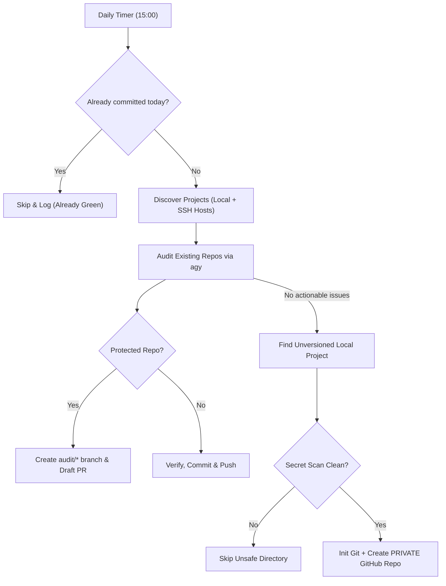

# git-pulse-agent

**An automated multi-host code auditor, private repository promoter, and GitHub contribution guardian powered by Antigravity CLI (`agy`) — with zero Python runtime dependencies.**

Designed for busy students and developers who juggle multiple machines (e.g., a Raspberry Pi + Linux workstation) and want real, verified daily engineering progress without losing their GitHub streak — while keeping critical research repositories strictly PR-only and newly discovered local projects strictly **private** until reviewed.

---

## Key Features

- **Dynamic Model Selection (`agy models`):** Automatically queries currently available models in Antigravity CLI and falls back cleanly on quota/capacity errors.
- **Multi-Host Project Discovery:** Scans both the local machine and SSH-connected hosts (with optional Wake-on-LAN `wake_command`) for:
  1. Existing Git repositories owned by you.
  2. Unversioned local scripts, automations, and infrastructure projects.
- **Strict Protected-Repo Guard (PR-Only Mode):** Repositories matching `protected_pr_only_patterns` (e.g. research / competition projects) **never** receive direct commits. Findings are isolated on an `audit/YYYY-MM-DD-*` branch and opened as a **Draft Pull Request** for human review.
- **Private-First Auto-Promotion:** If existing repositories need no changes, `git-pulse` discovers an unversioned local project, runs a strict secret scan, adds a defensive `.gitignore`, creates a **PRIVATE** GitHub repository, and runs an initial documentation/quality pass. When you're ready to open-source it, run `git-pulse publish <dir>` (which re-scans for secrets before flipping visibility).
- **Daily `systemd --user` Scheduler:** One command (`git-pulse install-timer --time 15:00:00`) sets up a persistent daily timer.

---

## Workflow



---

## Quickstart

```bash
git clone https://github.com/zynordev/git-pulse-agent.git
cd git-pulse-agent
pip install -e .

# Create and customize ~/.config/git-pulse-agent/config.json
cp config.example.json ~/.config/git-pulse-agent/config.json

# Verify GitHub streak, available agy models, and discovered projects
git-pulse status
git-pulse scan
git-pulse run --dry-run

# Enable daily 15:00 systemd user timer
git-pulse install-timer --time 15:00:00
```

## CLI Reference

| Command | Description |
| :--- | :--- |
| `git-pulse status` | Check today's GitHub contributions and available `agy` models |
| `git-pulse scan [--json]` | Discover git repos (with `PR-ONLY`/`DIRTY` tags) and unversioned projects |
| `git-pulse run [--force] [--dry-run]` | Execute the daily audit & streak-protection pipeline |
| `git-pulse secret-scan <dir>` | Scan a folder for tokens, API keys, and sensitive files |
| `git-pulse publish <dir>` | Secret-scan a private repo and flip it to public after review |
| `git-pulse install-timer [--time 15:00:00]` | Install & enable persistent daily `systemd --user` timer |
| `git-pulse uninstall-timer` | Remove `systemd --user` timer |

## Running Tests

```bash
PYTHONPATH=src python3 -m unittest discover -s tests -v
```

## License

MIT — see [LICENSE](LICENSE).
